<p align="center">
  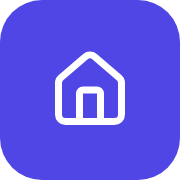
</p>

<h1 align="center">RentFlow for Android</h1>

<p align="center">
  A rent app for tenants and landlords. Landlords manage properties, rooms and the tenants living in them; tenants pay rent and keep receipts.<br>
  Built with Kotlin and Jetpack Compose, and designed to match the RentFlow web app’s phone layout.
</p>

> **Status:** sign-in, and the landlord’s properties, rooms, tenants and who lives in which room, run on the **live RentFlow API**, the same one the web app uses. So does the landlord’s **Rent Collection** (the Payments tab), from the bills API. So do the tenants’ payment statuses on the Tenants tab and every figure on Overview. The money figures on Profile, the wallet, and the tenant’s rent screens still show **sample numbers** (see [What’s next](#whats-next)).

## Contents

- [Screens](#screens)
- [App flow](#app-flow)
- [What uses real data](#what-uses-real-data)
- [Design system](#design-system)
- [Tech stack](#tech-stack)
- [Project structure](#project-structure)
- [Build and run](#build-and-run)
- [What’s next](#whats-next)
- [Credits and licences](#credits-and-licences)

## Screens

The screenshots are rendered from the approved design mockups the app was built from, with example names and numbers. The numbers match the screen numbers used during design review.

### Sign-in

The app opens on Login, on the role used for the last sign-in (Landlord the first time). It comes back here after logging out.

| 02 Login: Tenant | 02 Login: Landlord | 02 Login: One-time code |
|:---:|:---:|:---:|
| 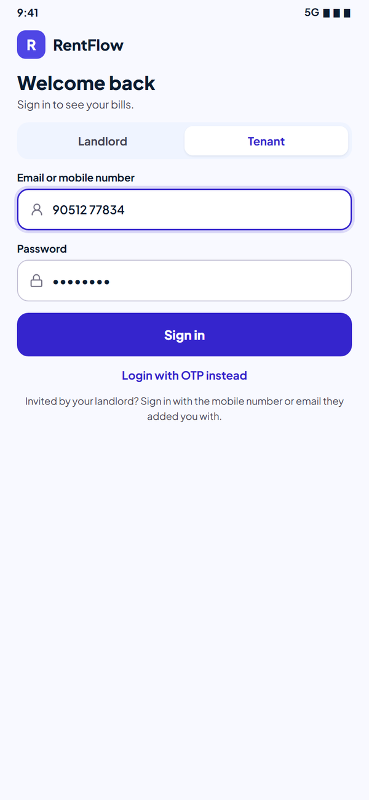 | 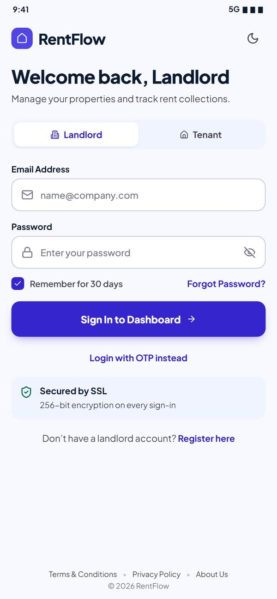 | 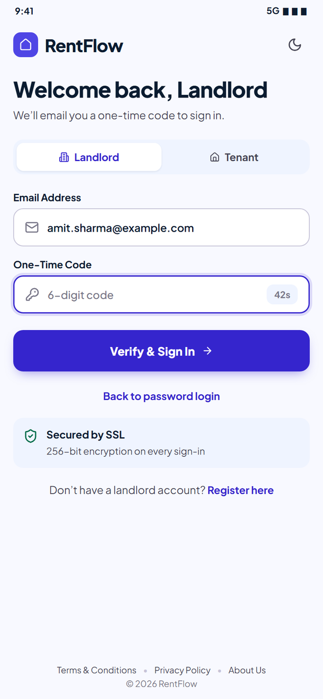 |
| One login for both roles. Email and password, with “Remember for 30 days”. | The switch changes the headline, subtitle and the “Register here” link. | “Login with OTP instead” emails a 6-digit code. Resend unlocks after 60 seconds. |

A wrong password or code floats up from the bottom as a red note. Buttons show a spinner while a request runs.

### Forgot password and registration

| 14 Forgot password | 14 New password | 14 Done | 15 Register (landlord) | 15 Verify email |
|:---:|:---:|:---:|:---:|:---:|
| 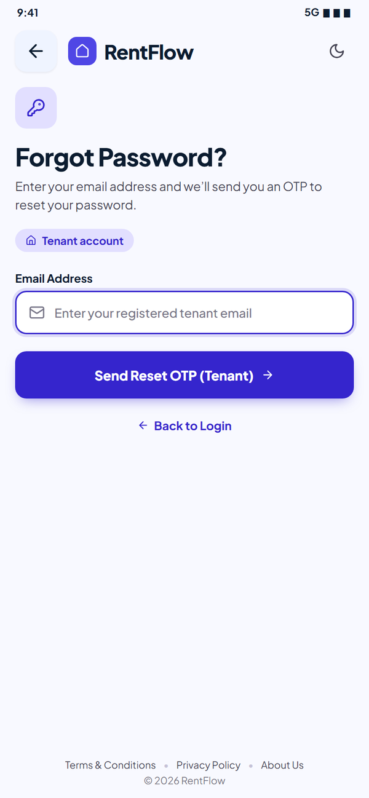 | 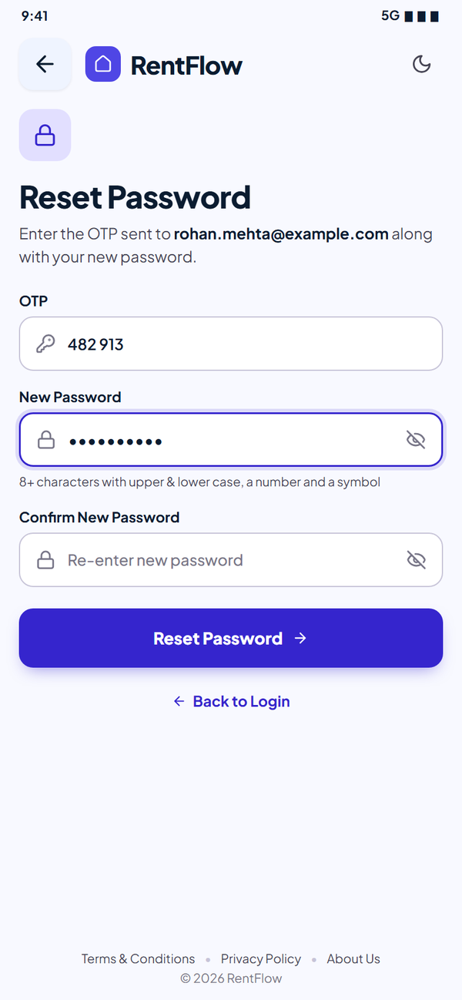 | 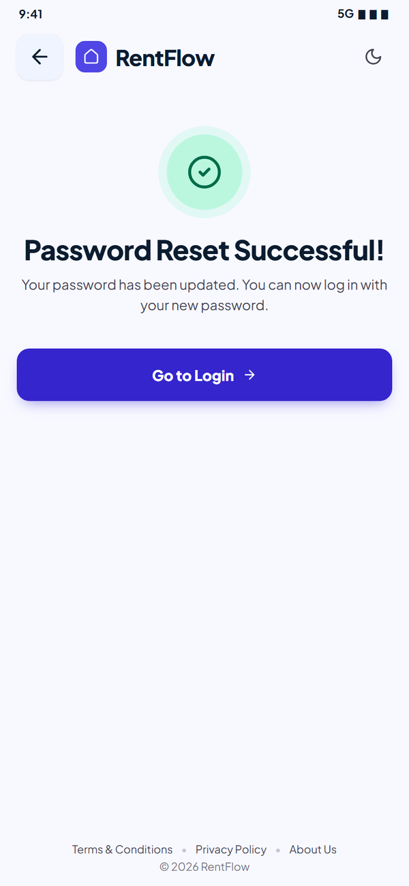 | 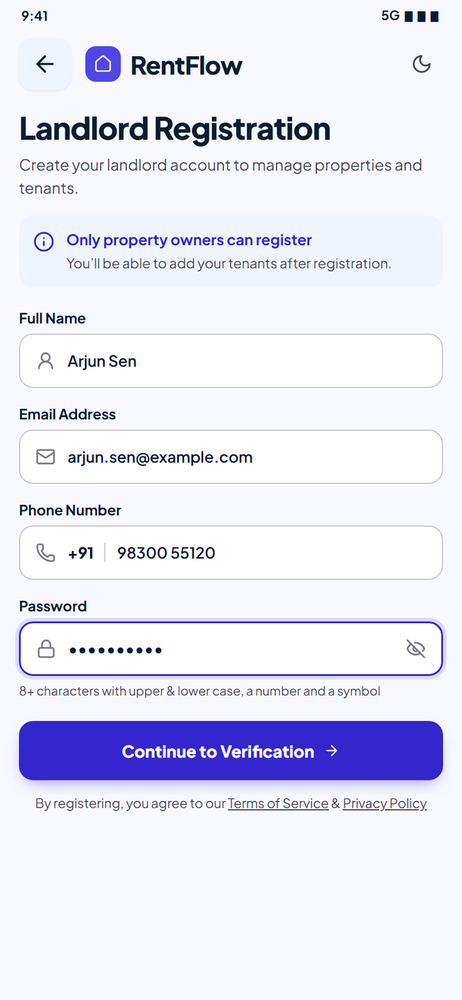 | 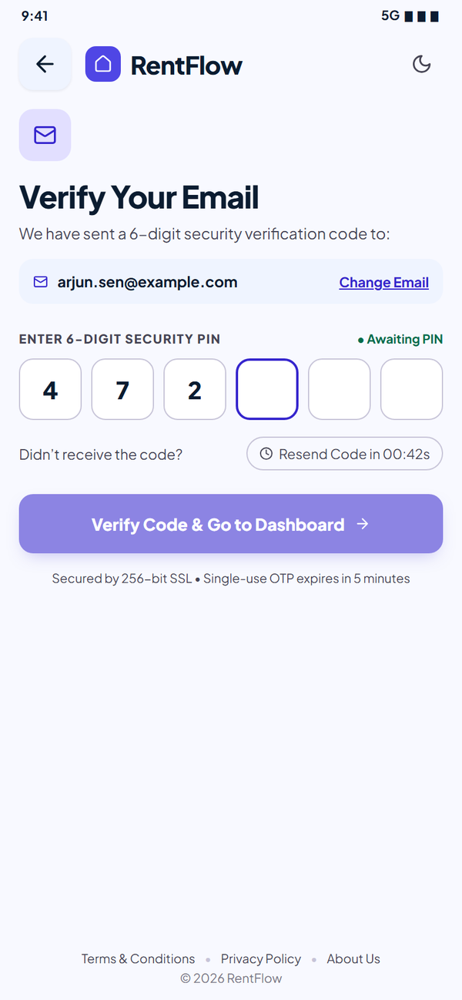 |
| Emails a reset code for the role chosen on login. | Code, new password and confirmation, with the password rule. | Confirms the reset and returns to login. | Only landlords sign up; they add their tenants later. Phone has a fixed +91. | Six code boxes. Once verified, the landlord is signed in. |

### Landlord

| 09 Overview | 10 Tenants | 11 Tenant Details | 12 Profile |
|:---:|:---:|:---:|:---:|
| 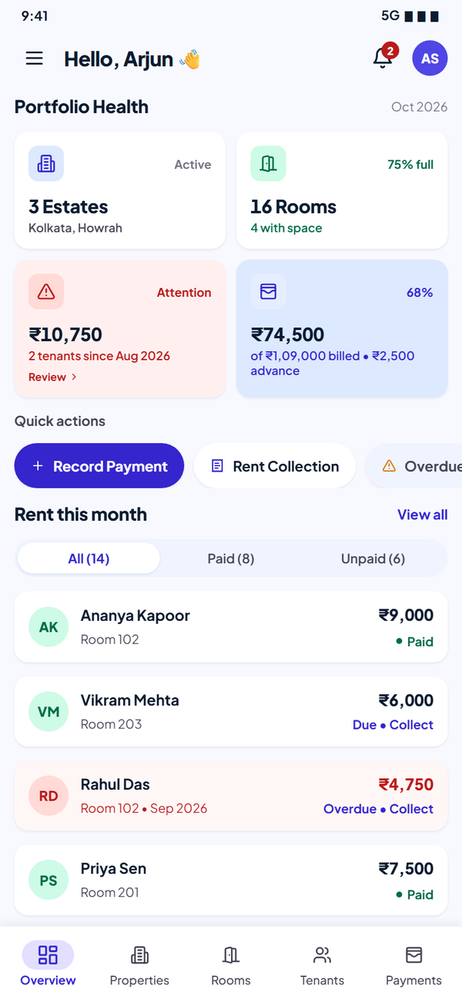 | 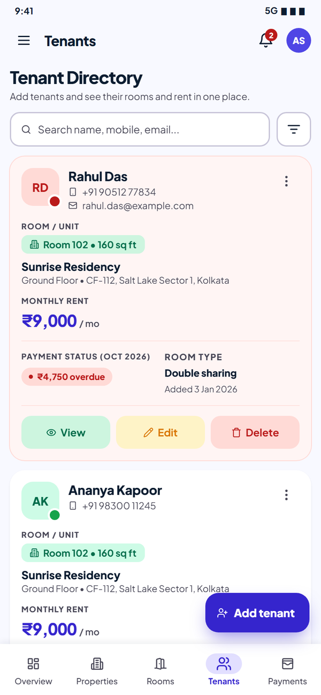 | 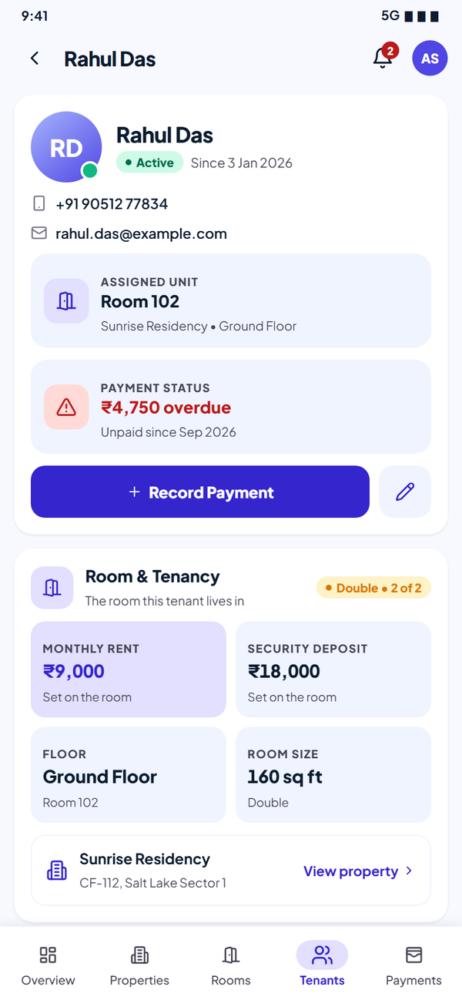 | 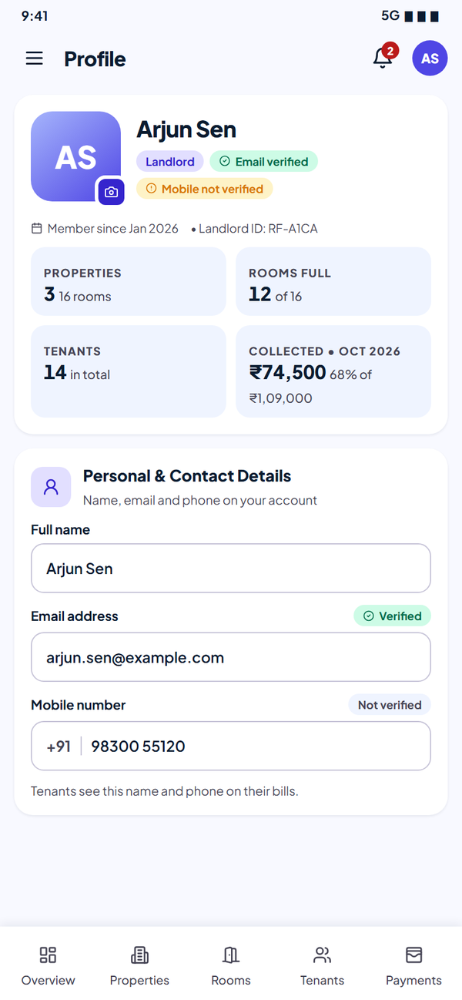 |
| The web’s phone dashboard (screenshot is the older design, [new mockup](https://claude.ai/artifact/LFReFdJCABQkYVgDePCrz4)): Portfolio Health (estates and cities, rooms “% full” and with space, overdue from earlier months, which opens those bills, and this month’s collected of billed with advance held); Record Payment, Rent Collection and Overdue; Rent this month (this month’s bills and the overdue ones, six at a time, All / Paid / Unpaid, Collect on unpaid ones); five property cards with “+ Add” and View All; and Electricity this month once a bill has a meter reading. | The web’s Tenant Directory (screenshot is the older design, [new mockup](https://claude.ai/artifact/RaTkLr6Mz9Z5k1pTrTXDQa)): search by name, mobile, email or room, and a Filters sheet for property and rent status (Overdue, Due, Paid, Not billed) with counts; filters that are on show as chips with “Clear all”. Each card: photo with a dot (green in a room, amber no room, red overdue), contacts, room and property, monthly rent, this month’s payment status from the bills, room type and date added, then View, Edit and Delete. ⋮ assigns, moves or removes the room, or calls the tenant. Every tenant is in one scroll. | The web’s tenant page (screenshot is the older design, [new mockup](https://claude.ai/artifact/ABML2dsqaiv3pPLiEQ6LpC)): photo, Active, since, mobile and email; the assigned unit and a payment status from the bills (overdue, due, advance, paid or not billed); Record Payment and Edit. Then Room & Tenancy, Roommates, Payment History, Contact & Account (Call, WhatsApp, email, how they sign in) and Tenancy Actions (change room, remove from room, delete). | Real owner details and counts. Edit profile and change password. |

### Properties and rooms

| 16 Properties | 17 Property Details | 18 Add or Edit Property |
|:---:|:---:|:---:|
| 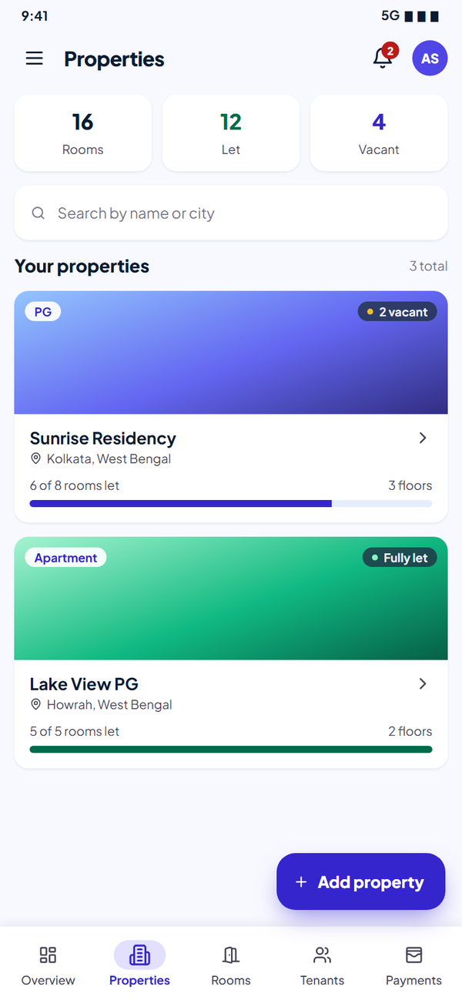 | 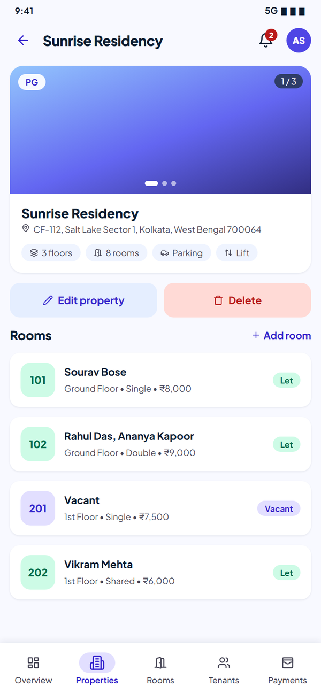 | 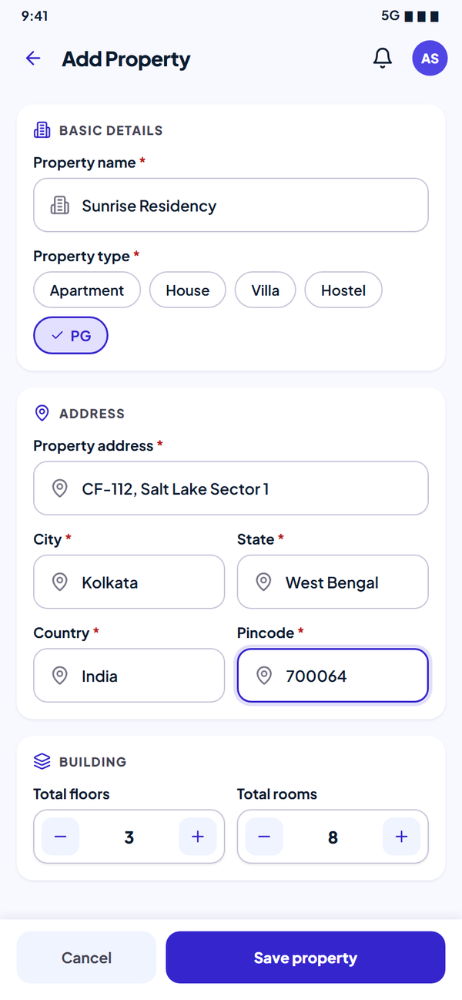 |
| Rooms, let and vacant counts, then a card per property with its cover photo and how many rooms are let. | Swipeable photos, address, floors, parking and lift, and every room with its tenant or “Vacant”. | The web form’s fields in short sections, with chips, switches and up to 10 photos. Mistakes show under the field. |

**26 Rooms tab** (no screenshot yet; [design mockup](https://claude.ai/artifact/2pPTYU1YF9Za16gYADb2PN)). The web’s phone room list: a Property dropdown, then the property’s cover, Monthly target, Total units, Full units and Units with space. Search by room number, type or size, and a Filters sheet with Status (All, Has space, Full) and Floor, each with its count; filters that are on show as chips you can tap off. Every room of the property is in one scroll (the web pages them ten at a time). Each card shows Empty, “1 of 2 filled”, Full or “3 tenants • shared”, the rent, swipeable photos, capacity bars, who lives there with a call button, features and the deposit, and “Assign Tenant” while the room has space. The tab remembers the property while the app runs.

**27 Payments: Rent Collection** (no screenshot yet; [design mockup](https://claude.ai/artifact/EL1TgnWtUmQXBppw8baabf)). The web’s phone Rent Collection: “Collected in Oct 2026” with the share of the billed amount, Still due and Advance held; a red “₹… overdue · Review” line that opens the bills still unpaid from earlier months; a month stepper (tap the month for a grid of months, no future ones), a property sheet and search; All / Pending / Partial / Paid tabs with counts; a card per bill with its status, total, received and due, a bar of how much is covered (advance in indigo, money in green) and any advance used. Tenants in a room with no bill for the month are listed under “Review”. Tapping a bill opens its details in a bottom sheet: totals, breakdown with the meter readings, payment, advance (and which later bill used it) and the meter photo or payment proof (a PDF opens in the phone’s viewer). From there: **Collect ₹…**, **Edit bill** (the Record Payment form on the saved bill), **Delete** (the confirmation says what happens to the advance), and add, change or remove the meter photo or payment proof, saved right away.

**29 Rent History** (same mockup). Opened from **History** on Rent Collection or the side menu. The web’s page: All properties or one, Last 6 months / Last 12 months / the financial year (April to March); Billed, Collected (with the share of billed), Still due (and how much of it is overdue) and Advance held; a chart of collected and still due for each month (tap a month for its figures, tap again to open it); and the months newest first, tagged This month, Overdue or Fully collected. A month opens Rent Collection on that month and property. **CSV** shares the months through Android’s share menu.

**Payment History on a tenant’s page.** Billed, Received, Still due and (once there was any) Advance held; All / Pending / Partial / Paid; every month’s bill, six at a time with “Show more”, each with Collect while something is due; Record Payment; and **Export CSV**, the tenant’s statement in the web’s columns, through Android’s share menu.

**28 Record Payment** (same mockup). The floating **Record** button asks “Who is it for?” (tenants in a room, each marked “Bill exists” or “Not billed”), and **Collect** on a bill or **Create bill** for a tenant not billed opens the form straight away. The web’s form: billing month (the last 12, “bill exists” marked); for a new bill, rent filled in from the room, electricity with the previous reading and rate carried on from the room’s last bill (and a warning in a shared room), an optional meter photo, other charges with WiFi / Gas / Maintenance / Water chips; for a bill that exists, what it holds and “Received now”; on a fully paid bill, “Receive an advance”. Then the amount (Full amount / Half / Not received yet), Cash / UPI / Cheque, the date, an optional proof (photo or PDF) and notes, and a bill summary. Advance is previewed with the backend’s rules: advance from earlier bills that comes off this one, money beyond the bill and which later month uses it, and earlier months still due. The button says what is saved, e.g. “Save bill + ₹5,500 payment”.

| 19 Room: let | 19 Room: vacant | 20 Add or Edit Room |
|:---:|:---:|:---:|
| 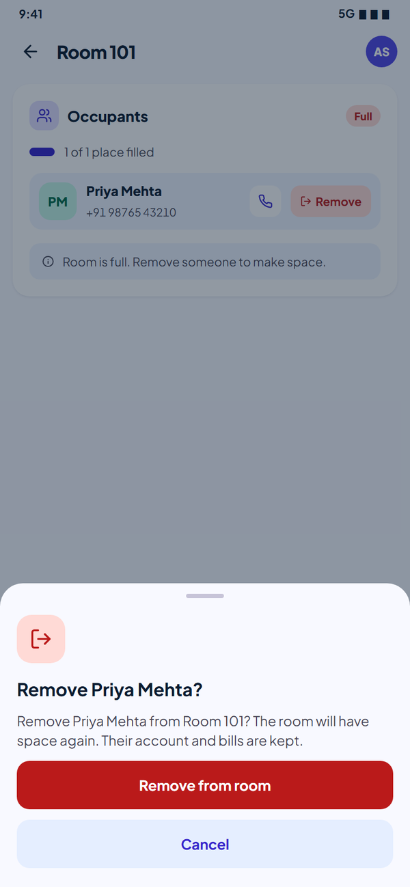 | 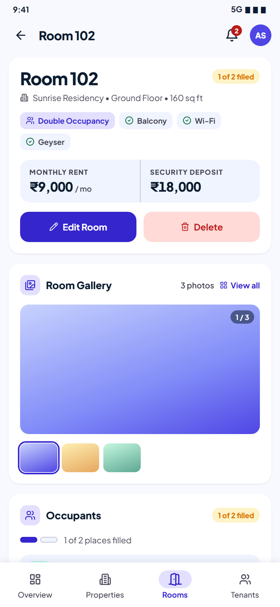 | 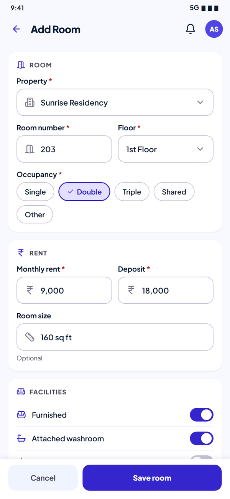 |
| The web’s room page (screenshot is the older design, [new mockup](https://claude.ai/artifact/ADQYehGDjWwaNptkNe6RED)): room number, property, floor and size with Empty / “1 of 2 filled” / Full; occupancy and amenity chips; Monthly Rent and Security Deposit; Edit Room and Delete. Then the Room Gallery (swipe, thumbnails, full screen), Occupants with capacity bars, Call and Remove on each person, Room Details tiles and the Property with “View Property”. | A room with space offers “Assign Tenant”; a full one says “Room is full. Remove someone to make space.” A room with tenants can’t be deleted until they are removed. | Room number, floor, occupancy, rent, deposit, facilities and photos. |

### Adding tenants and giving them rooms

| 21 Add tenant: details | 21 Add tenant: room | 22 Edit Tenant | 23 Assign Room |
|:---:|:---:|:---:|:---:|
| 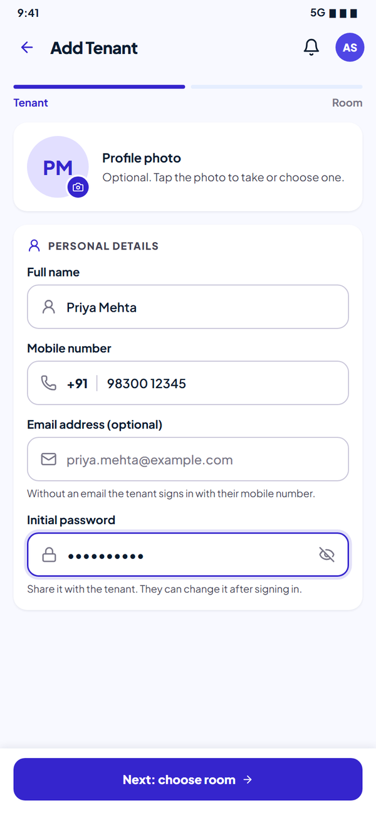 | 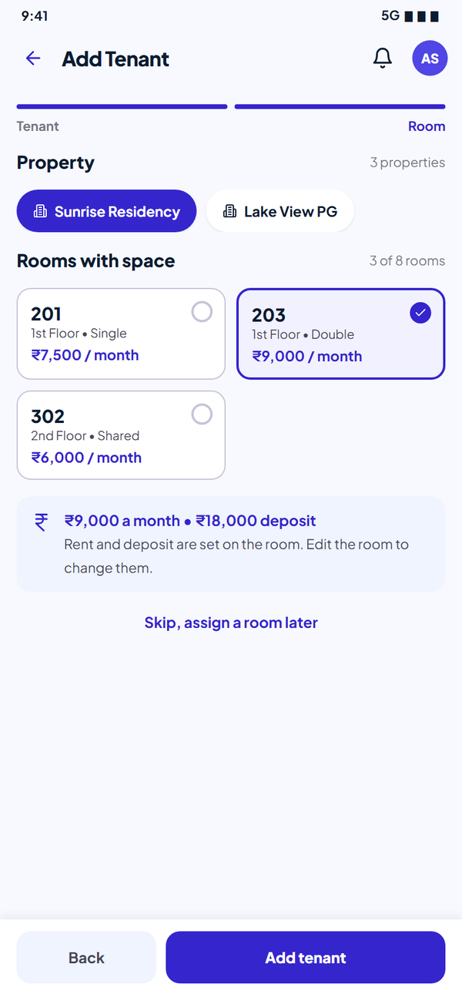 | 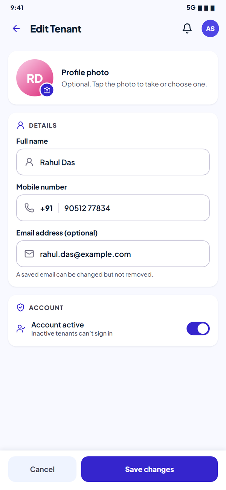 | 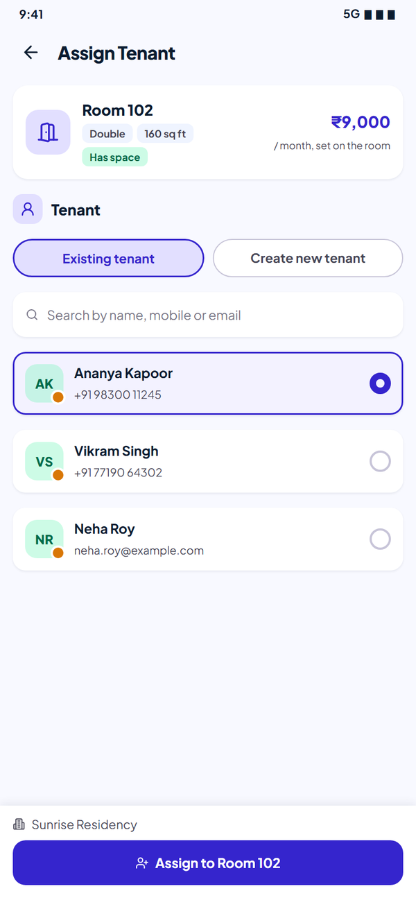 |
| Name, mobile, an optional email, initial password and an optional photo. A mobile or email already in use is named in the error. | Pick a property, then a room with space. Rent and deposit are the room’s. The room can be skipped. The same screen changes a tenant’s room. | Name, mobile, email, photo and whether the account is active. A saved email can be changed but not removed. | The web’s Assign Tenant dialog: the room and its rent, then “Existing tenant” (search the tenants without a room) or “Create new tenant” (name, mobile, optional email; the password starts as Tenant@123), and “Assign to Room …”. |

### Profile settings

| 24 Edit Profile | 25 Change Password |
|:---:|:---:|
| 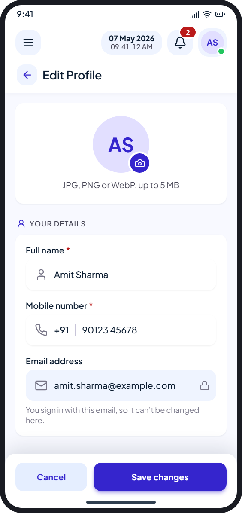 | 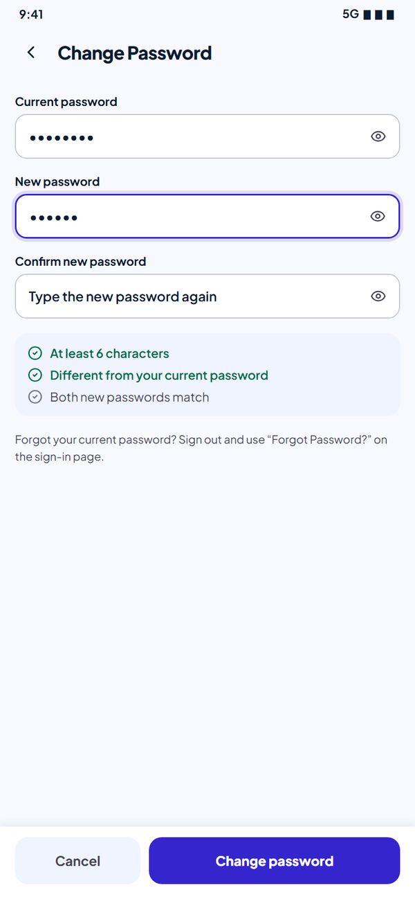 |
| Photo, name and mobile. The sign-in email is locked. | Current password, then the new one twice, with the password rule. |

### Confirmations and list states

| Remove from room | Delete | Loading | Empty | Can’t connect |
|:---:|:---:|:---:|:---:|:---:|
| 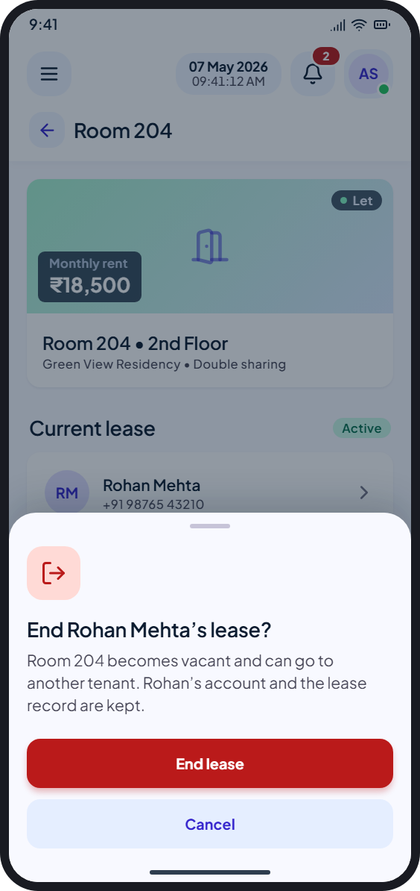 | 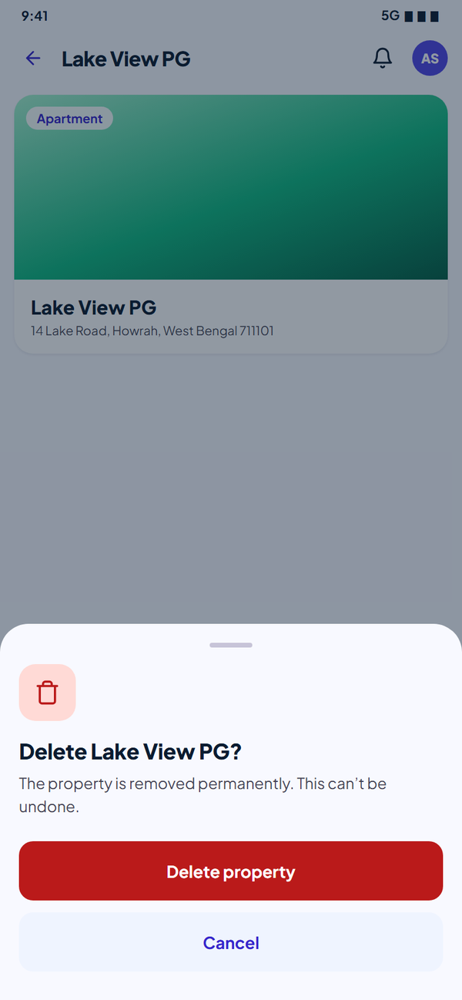 | 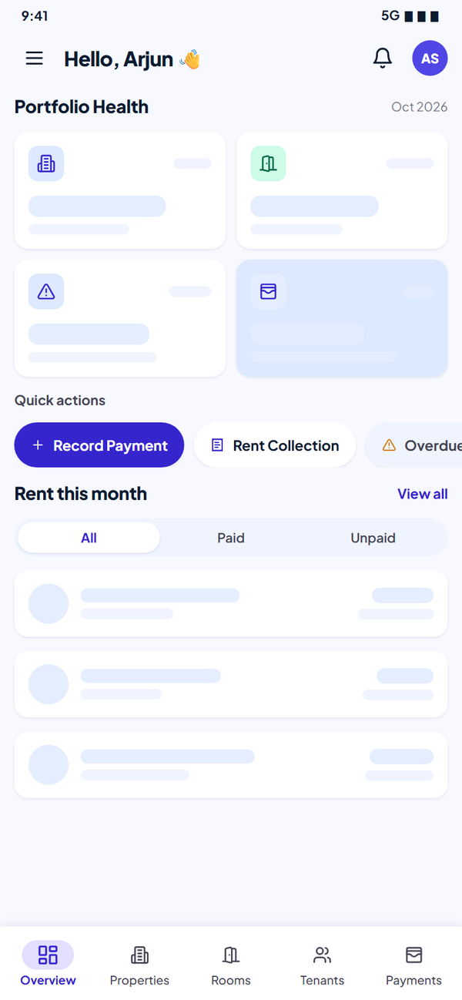 | 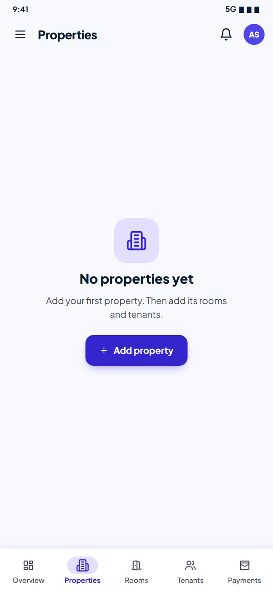 | 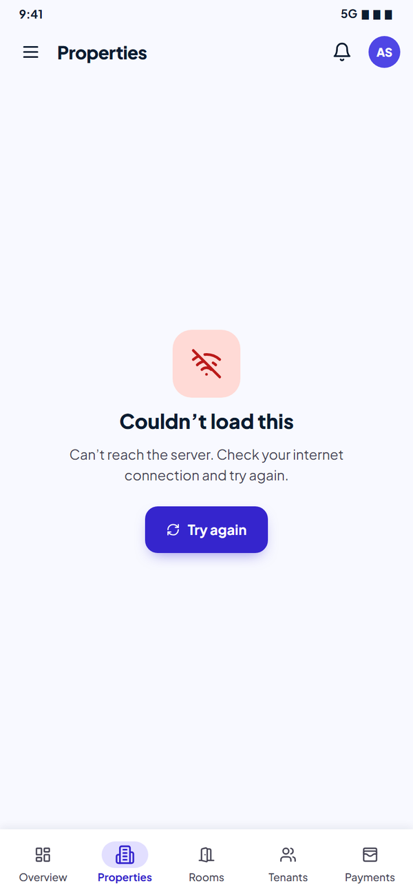 |
| Says what happens before a tenant leaves a room. | Deletes ask first. A property or room with tenants can’t be deleted until they are removed from it. | Placeholder cards that pulse, as on the web, while a list loads. | A first-time landlord sees what to add first. | The reason and a “Try again” button. |

After every save or delete, a short message such as “Property saved” floats up from the bottom.

### Tenant

| 03 Home | 04 Pay Rent | 05 Payment Success |
|:---:|:---:|:---:|
| 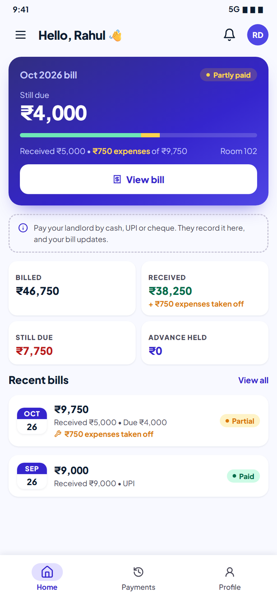 | 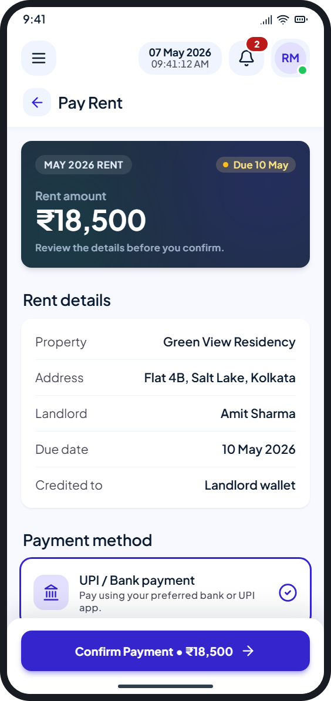 | 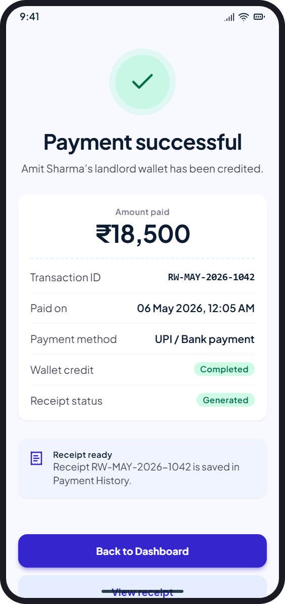 |
| This month’s rent with a Pay rent button, quick actions, lease tiles, alerts and recent payments. | Rent details, payment method and summary. Confirm sits in a bottom sheet. | Confirmation with the transaction details. Links to the receipt. |

| 06 Payment History | 07 Receipt | 08 Profile |
|:---:|:---:|:---:|
| 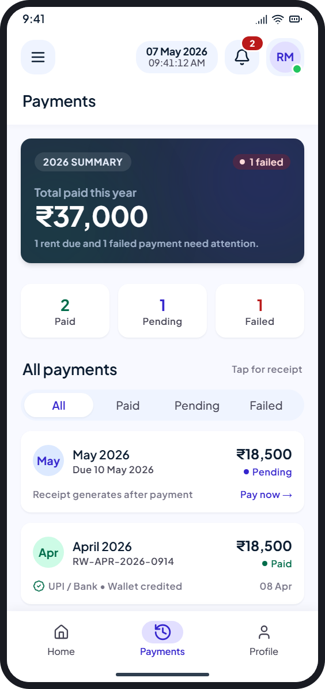 | 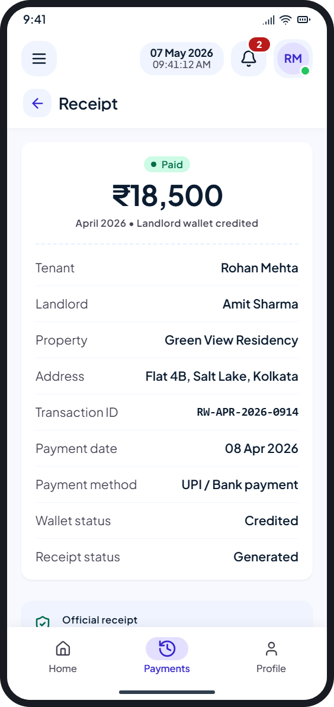 | 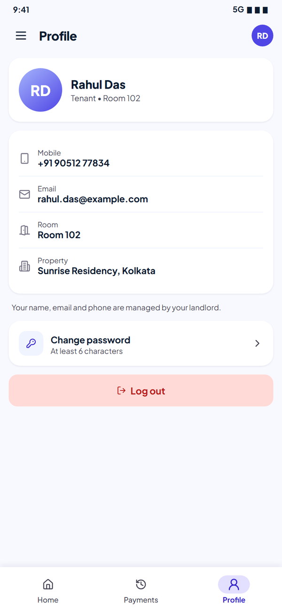 |
| Year summary, counts and every payment, filtered by All, Paid, Pending or Failed. | One receipt card with the transaction and wallet status. | Real name, email and mobile; rent and lease rows are sample data. Log out. |

The tenant’s rent screens use sample data until the tenant payment and lease APIs exist.

## App flow

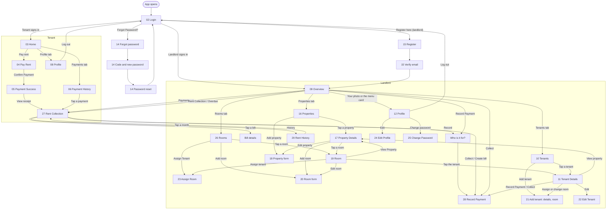

How navigation works:

- **Bottom tabs.** Tenants have Home, Payments and Profile. Landlords have Overview, Properties, Rooms, Tenants and Payments, as on the web. A room opened from the Rooms tab keeps Rooms lit, and from a property keeps Properties lit. A landlord’s Profile is not a tab: it opens from your photo in the top bar or your card in the side drawer.
- **Top bar.** The menu button opens the side drawer. The bell shows how many notifications are unread and opens them in a bottom sheet, the moon/sun button switches the theme, and your photo opens Profile. Inner screens show a back arrow and the screen title.
- **Side drawer.** As on the web: 260 dp wide (at most 85% of the screen) and navy in both themes, with the logo, the menu, and a card with your photo, name and role that opens Profile. Log out is the icon on that card. A landlord’s menu is the web sidebar: Dashboard, Properties, Rooms and Tenants open those tabs, Rent Collection opens Payments and Rent History opens its page; Rent Settings, Expenses, Reports and Settings are listed as on the web but do nothing yet. A tenant’s menu is their three tabs.
- **Back button.** Screens form a stack, so Back returns to the screen you came from. A tab goes back to the home screen; on a home screen or Login, Back leaves the app.
- **Staying signed in.** With “Remember for 30 days”, the app opens signed in next time. Without it, the session ends when the app closes. If the server rejects the saved session, the app returns to login and says why.

## What uses real data

| Screen | From the API | Sample data |
|---|---|---|
| Login, OTP, Forgot password, Register | Everything | None |
| Landlord Overview | Everything: estates, rooms, overdue, collected, this month’s rent, properties, electricity | None |
| Properties, property details, rooms | Everything: list, details, add, edit, delete, photos | None |
| Rooms tab | Everything: the property’s rooms, who lives in each, counts, filters | None |
| Payments: Rent Collection | Everything: the month’s bills and totals, overdue bills, tenants not billed, bill details | None |
| Record Payment | Everything: new bills, money received, advance, meter photo and payment proof uploads | None |
| Rent History | Everything: monthly totals from `/landlord/payment/summary`, chart, CSV | None |
| Tenants, tenant details | Names, contacts, rooms, rent and deposit. Add, edit, delete, assign or change a room, remove from a room. This month’s payment status on the list and the tenant page, and the tenant’s Payment History | None |
| Landlord Profile | Name, email, mobile, photo, counts. Edit profile, change password | Collection tiles, wallet, bank account |
| Tenant Profile | Name, email, mobile | Rent and lease rows |
| Tenant Home, Pay Rent, Payments, Receipt | None yet | Everything |
| Bell and notifications (both roles) | Unread count, the list 20 at a time | None |

Every call is one the web app already makes. The landlord endpoints are under `/api/v1/landlord` (property, room, tenant, `tenant/assign-room`, profile). Edits send the record’s id in the body, not the URL, photos go through `/api/v1/upload/presigned`, and sign-in uses `/api/v1/{landlord|tenant}/auth`. Notifications use `/api/v1/notification` and `/api/v1/notification/count`, and the phone's FCM token goes to `PUT /api/v1/fcm-token`.

## Design system

The app copies the phone design of the RentFlow web app (`rent-management-ui`), so both look the same.

**Colours.** One primary colour for both roles, from the web’s Material 3 tokens ([`Color.kt`](app/src/main/kotlin/com/thebackendguy/rentflow/ui/theme/Color.kt)):

| Role | Hex | | Role | Hex |
|---|---|---|---|---|
| Primary | `#3525CD` | | Surface | `#F8F9FF` |
| Primary container | `#4F46E5` | | Surface container low | `#EFF4FF` |
| Primary fixed | `#E2DFFF` | | Surface container | `#E5EEFF` |
| Secondary (success) | `#006C4A` | | On surface | `#0B1C30` |
| Secondary container | `#82F5C1` | | On surface variant | `#464555` |
| Error | `#BA1A1A` | | Inverse surface (dark cards) | `#213145` |

**Dark theme.** The moon/sun button in the top bar (and next to the logo on the sign-in screens) switches the whole app between light and dark. Dark uses the web’s dark phone palette (surface `#0C1424`, cards `#152036`, primary `#AEB0FF`, success `#68DBA9`, error `#FFB4AB`). Until the user picks one, the app follows the phone’s setting, and the choice is kept after logging out. The launch screen matches too: dark when the phone is in dark mode, and on Android 12+ in whichever theme was picked last. The navy summary cards and the side drawer look the same in both themes.

**Type.** Plus Jakarta Sans, with the web’s phone type scale ([`Type.kt`](app/src/main/kotlin/com/thebackendguy/rentflow/ui/theme/Type.kt)):

| Style | Size / line height | Weight | Used for |
|---|---|---|---|
| Metric | 32 / 38 | Bold | Big amounts (₹18,500) |
| Headline large | 28 / 36 | Bold | Login and auth headlines |
| Headline medium | 22 / 28 | SemiBold | App name next to the logo |
| Headline small | 18 / 24 | SemiBold | Section titles, top bar title |
| Body large / medium / small | 16 / 14 / 13 | Regular | Text |
| Label medium / small | 13 / 11 | SemiBold | Buttons, chips, captions |

**Icons.** Lucide v0.488, the same set and version as the web. They’re generated into [`Lucide.kt`](app/src/main/kotlin/com/thebackendguy/rentflow/ui/icons/Lucide.kt) from the web project’s icon data.

**Logo.** The web Home page logo: a `#4F46E5` tile with a white Lucide “Home” icon. It is also the adaptive launcher icon ([`ic_launcher_foreground.xml`](app/src/main/res/drawable/ic_launcher_foreground.xml)).

**Components.** Cards with 12 dp corners and a soft shadow, dark summary cards, pill-shaped filters with a sliding thumb, quick-action chips that scroll sideways, and a bottom bar with the Material 3 pill indicator. Forms use choice chips, switches, steppers, dropdowns, a date picker and a photo grid, with the save button in a bar pinned to the bottom. Buttons shrink slightly when pressed instead of showing a ripple, as on the web.

**Photo crop and preview.** Photos can be taken with the camera or picked from the gallery, and each one opens in a crop screen first: move and pinch the photo under a frame with a 3×3 grid, pick Original, 4:3, 16:9 or 1:1, and rotate it a quarter turn at a time. Several photos are cropped one by one, or added as they are with “Use all as they are”. Profile photos are cropped in a round 1:1 frame. Tapping a photo in a form opens it full screen: swipe between photos, pinch or double-tap to zoom, and Crop (new photos), Make cover or Remove. New photos are copied into the app’s own folder straight away, so they survive Android closing the app while the camera is open.

**Photos on a slow network.** While a property or room photo downloads, its indigo placeholder shows a light band sliding across it; the photo then fades in, and if it can’t be fetched the placeholder offers “Tap to retry”. Profile photos show the Stitch design’s Wave Sweep (a ring of colour, a pulse, a sweep and a camera icon) and fall back to the person’s initials, with a retry button on the larger ones. Lists that load for the first time show placeholder cards, and figures that wait for data (Overview’s portfolio tiles, a tenant’s payment status and Payment History, the status pills on the Tenants tab, Profile’s counts) show grey bars of the text’s size instead of “Loading…”. Both pulse like the web’s placeholders (fading to 40% and back every 2 seconds), and the real text fades in when it arrives ([design mockup](https://claude.ai/artifact/7p14L17482HEJbigBuxvXw)). Photos already downloaded are kept on the phone and show without a network.

## Tech stack

| | |
|---|---|
| Language | Kotlin 2.2 |
| UI | Jetpack Compose (BOM 2024.09), Material 3 |
| Android | minSdk 28, targetSdk and compileSdk 36 |
| Build | Android Gradle Plugin 9.3, Gradle version catalog |
| Networking | Retrofit 3, OkHttp 4.12, kotlinx.serialization 1.9 |
| Images | Coil 3 with 15 s connect / 30 s read timeouts; photos are resized to 1600 px JPEGs before upload |
| Theme | Light and dark palettes in [`Color.kt`](app/src/main/kotlin/com/thebackendguy/rentflow/ui/theme/Color.kt); the choice is saved in SharedPreferences |
| Session | Token and account details in SharedPreferences (only with “Remember me”) |
| Navigation | A back stack of screens in Compose state, no navigation library |
| Push notifications | Firebase Cloud Messaging (Firebase BoM 34.19, google-services plugin 4.5) |
| Sample data | [`DemoData.kt`](app/src/main/kotlin/com/thebackendguy/rentflow/data/DemoData.kt) for rent, payments and wallet |

## Project structure

```
app/src/main/
├── kotlin/com/thebackendguy/rentflow/
│   ├── MainActivity.kt           # Screens, back stack, drawer, session handling
│   ├── data/
│   │   ├── AuthRepository.kt     # Sign-in, OTP, password reset, registration, log out
│   │   ├── LandlordStore.kt      # Properties, rooms and tenants; every add, edit and delete
│   │   ├── NotificationStore.kt  # The bell's unread count and the notification list
│   │   ├── Labels.kt             # Floors, dates, amounts and types as the web shows them
│   │   ├── DemoData.kt           # Sample rent, payments and wallet; ₹ formatting
│   │   ├── session/              # SessionStore: the signed-in account and token
│   │   └── remote/               # ApiConfig (server address), Retrofit APIs, DTOs, photo uploads
│   ├── push/                     # Firebase messaging service, notification channel, FCM token in Logcat
│   └── ui/
│       ├── theme/                # Light and dark colours, type, theme switch
│       ├── icons/                # Lucide.kt (generated), LucideIcon.kt
│       ├── components/           # Cards, buttons, fields, forms, states, side drawer, photos: loaders, picker, crop, preview
│       └── screens/
│           ├── Shell.kt          # Top bar and tabs per role, profile header, log out button (drawer in components/Drawer.kt)
│           ├── NotificationsSheet.kt # The bell's bottom sheet: Today / Yesterday / Earlier, Load more
│           ├── auth/             # Login, Forgot Password, Register
│           ├── tenant/           # Home, Pay Rent, Payment Success, History, Receipt, Profile
│           └── landlord/         # Overview, Properties, Rooms, Tenants, room assignment, Profile
├── res/
│   ├── font/plus_jakarta_sans.ttf
│   ├── drawable/                 # Launcher icon layers, notification icon
│   ├── xml/                      # Network security, FileProvider paths for new photos
│   ├── values-night/             # Dark launch-screen background
│   └── values/                   # App name, colours, window theme
└── assets/licenses/OFL-PlusJakartaSans.txt
```

## Build and run

1. Download `google-services.json` from the Firebase console (Project settings → Your apps → RentFlow) and put it in `app/`. It is kept out of git, and the build fails without it.
2. Open the project in Android Studio.
3. Let Gradle sync, then run the **app** configuration on a device or emulator (Android 9 or newer). For push notifications the emulator needs a Google Play system image.

From the command line:

```bash
./gradlew assembleDebug
```

On Windows use `gradlew.bat assembleDebug`. The APK is written to `app/build/outputs/apk/debug/app-debug.apk`.

### Choosing the server

The server address is set in code, in [`ApiConfig.kt`](app/src/main/kotlin/com/thebackendguy/rentflow/data/remote/ApiConfig.kt). Keep one line and comment out the other:

```kotlin
// const val BASE_URL = "http://localhost:4000"          // local backend
const val BASE_URL = "https://api.thebackendguy.click"   // live
```

For the local backend on a phone connected by USB, forward the port once per connection:

```bash
adb reverse tcp:4000 tcp:4000
```

On Wi-Fi, use your PC’s IP instead of `localhost`, and add that IP to [`network_security_config.xml`](app/src/main/res/xml/network_security_config.xml). Plain `http` is allowed only for the addresses listed there; the live server uses `https`.

### Testing push notifications

After login the app asks for notification permission (Android 13+). Filter Logcat by `RentFlowPush` and copy the `FCM token`. In the Firebase console open Messaging, create a notification, and use **Send test message** with that token. The notification shows with the app in the background and in the foreground, and opens the app when tapped.

Every time Overview or the tenant Home opens, the app sends its FCM token to the server (`PUT /fcm-token`); logging out removes it. The bell's count refreshes then, when the app comes back to the front, and when a push arrives while the app is open. Opening the bell loads the list, and the server marks every notification read at that moment, so the badge clears. Unread ones stay highlighted until the sheet is opened again.

### Notifications sheet

- Loading rows while the first page loads, then the list grouped into Today, Yesterday and Earlier, newest first.
- Each notification has an icon for its type (rent reminder, payment, property, booking, message, system), the time (“12 min ago” today, “6:40 PM” yesterday, “25 Sep” before that) and, if it was unread, a tint and a dot.
- 20 at a time with a Load more button, “You’re all caught up” when there are none, and Try again when it can’t load.
- Tapping a notification does nothing yet: the push data doesn’t say which tenant, room or payment it is about.

## What’s next

The app uses the same backend as the web app (`rent-management`, Express and MongoDB, base path `/api/v1`).

1. ~~**Sign-in:** login with password or code, forgot password, registration, log out and remembering the session.~~ Done.
2. ~~**Landlord data:** properties, rooms, tenants and who lives in which room, with add, edit and delete.~~ Done.
3. **Tenant rent screens:** need backend work first. Payments must be limited to the signed-in user (today `/tenant/payment` returns everyone’s), and tenants need an endpoint for their own lease.
4. **Landlord collections:** the backend now has bills (`/landlord/payment`, `/landlord/payment/summary`). Rent Collection, Record Payment, bill details, the tenant’s Payment History and Rent History use them; the Tenants tab and Overview use them too; the money on Profile comes next ([design mockup](https://claude.ai/artifact/EL1TgnWtUmQXBppw8baabf)).
5. **Payments gateway and wallet (optional):** today the backend records payments (cash, UPI or cheque) but moves no money, so there is no wallet or withdrawal yet.
6. **Notifications, next steps:** to open the right screen from a notification, the backend should put its type and the tenant, room or payment id in the push data. Opening the list marks every notification read, even ones on later pages; a mark-read endpoint for the ones shown would be more exact. Firebase deprecated the FCM token for the Firebase installation ID in firebase-messaging 25.1; moving to it needs the backend to send with `fid` too.
7. **Smaller photos (optional):** if the backend also saved a small copy of each photo (about 400 px) or a blur hash, lists would load much faster on 3G and could show a blurred preview first.

Also worth fixing in the backend: deleting a property leaves its rooms behind. The app avoids the worst case by not deleting a property or room that still has tenants.

## Credits and licences

- [Plus Jakarta Sans](https://github.com/tokotype/PlusJakartaSans), SIL Open Font License 1.1 (licence in `app/src/main/assets/licenses/`).
- [Lucide](https://lucide.dev) icons, ISC License.
- [Coil](https://coil-kt.github.io/coil/), [Retrofit](https://square.github.io/retrofit/) and [OkHttp](https://square.github.io/okhttp/), Apache License 2.0.
